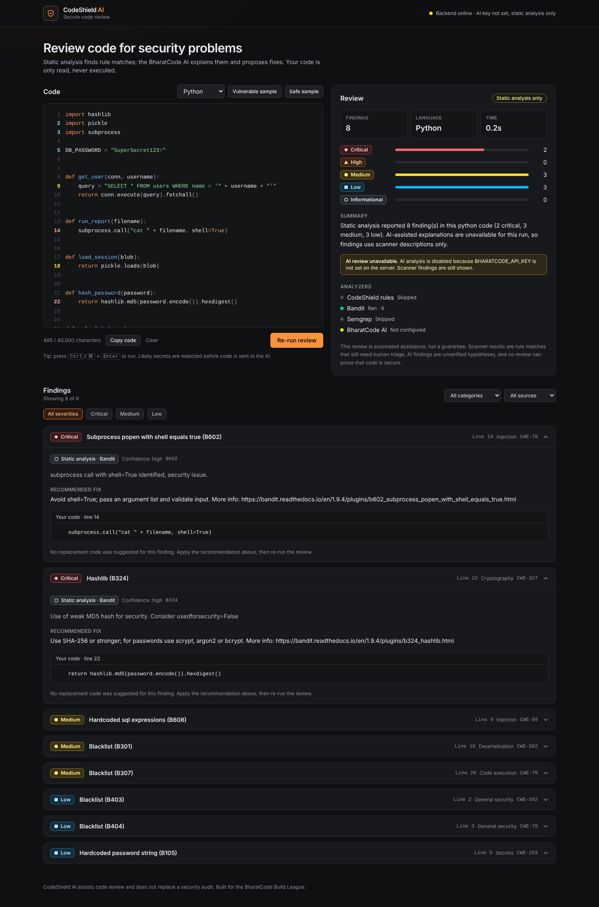

# CodeShield AI

Secure code review for developers. Paste code, get findings from **static analysis** and **AI-assisted explanations** (BharatCode API), with severity levels, safer replacement code and a re-check loop. Built for the BharatCode Build League.



## How it works

1. **Static analysis** reads your code (it is never executed): Bandit for Python, built-in language-aware rules for JavaScript, TypeScript, Java and C, and optional Semgrep.
2. **BharatCode AI** (`qwen-3.8-27b`) explains each scanner finding in plain language, suggests a fix, and may propose extra findings.
3. Every AI reply is **validated** with Pydantic before display. Invalid items are dropped, and a malformed reply gets one repair attempt.
4. The UI labels each finding's origin: **Static analysis** (a rule matched) or **AI hypothesis** (unverified). AI hypotheses are capped at High, and their code snippets always come from your submitted code, never from the model.

The app never claims code is secure. If the AI is unavailable, you get scanner results plus a visible notice; AI output is never fabricated.

## Features

- Languages: Python, JavaScript, TypeScript, Java, C
- Severity levels (Critical to Informational), filters by severity, category and source
- Dashboard: totals, severity bars, language, status, summary, analyzer status
- Side-by-side original vs suggested code, copy fix, re-run after edits (stale-result warning)
- Vulnerable and safe samples for every language (`samples/`)
- Loading, cancel, timeout, rate-limit and API-failure handling
- Secrets are redacted before code is sent to the AI; line numbers are preserved
- Server-side API key only; input size limits; CORS allow-list; per-client rate limit; no stack traces to clients

## Quick start

Requirements: Python 3.11+, Node 20+.

```bash
# 1. Backend
cd backend
python -m venv .venv && source .venv/bin/activate      # Windows: .venv\Scripts\activate
pip install -r requirements-dev.txt
cp ../.env.example .env                                 # then edit .env
uvicorn app.main:app --port 8000

# 2. Frontend (new terminal)
cd frontend
npm install
npm run dev                                             # http://localhost:5173
```

## BharatCode API setup

1. Create an API key at <https://bharatcode.ai>.
2. Put it in `backend/.env` as `BHARATCODE_API_KEY=...`. The key is read only by the backend and never reaches the browser.
3. Defaults (override in `.env` if the official docs differ): base URL `https://bharatcode.ai/api/model/v1`, endpoint `POST /chat/completions`, `Authorization: Bearer <key>`, model `qwen-3.8-27b`.

The whole integration is in `backend/app/services/bharatcode.py` (client, prompt, parsing, errors, redaction). Without a key, the app runs in static-analysis-only mode and says so. `GET /health` shows whether AI is configured.

## Tests

```bash
cd backend && pytest                 # 82 tests: validation, scanners, API failures, parsing, timeouts
cd frontend && npm test              # 20 tests: review workflow, filters, errors, safe rendering
cd frontend && npm run build         # typecheck + production build
```

Backend tests use mocked HTTP transports, so they need no API key or network.

## API

| Endpoint | Purpose |
| --- | --- |
| `GET /health` | Status, version, whether AI is configured |
| `GET /api/rules` | Languages, limits, scanner availability, built-in rules |
| `POST /api/review` | `{ "code": "...", "language": "python" }` returns findings, counts, summary, scanner and AI status |

Errors are `{ "error": { "code", "message" } }` with codes such as `empty_code`, `unsupported_language`, `code_too_large`, `rate_limited`, `analysis_unavailable`.

## Configuration

See `.env.example`. Notable: `MAX_CODE_CHARS`, `MAX_CODE_LINES`, `RATE_LIMIT_PER_MINUTE`, `CORS_ORIGINS`, `SEMGREP_CONFIG` (Semgrep runs only if installed and this is set).

## Deployment

- **Backend**: any host that runs `uvicorn app.main:app` (Render, Railway, Fly.io, a VM). Set `BHARATCODE_API_KEY` as a private environment variable and `CORS_ORIGINS` to your frontend URL.
- **Frontend**: `npm run build`, then deploy `frontend/dist` to any static host. Set `VITE_API_BASE_URL` at build time to the backend URL.

## Project layout

```
backend/app/{main,config,schemas}.py
backend/app/services/{bharatcode,analyzer,review}.py
backend/tests/
frontend/src/{components,pages,services}/
samples/            demo inputs shared by the app and tests
BharatCode.txt      Build League submission file
```

## Known limitations

- The official BharatCode API docs page was not reachable while building. The API details above come from the provider catalog and public repos, and no live call has been made yet. Verify with your key before relying on AI output.
- No JSON-schema mode is assumed. Structured output is requested in the prompt and validated.
- Built-in JS/TS/Java/C rules are line-based pattern matches (no data-flow analysis), so expect false positives and misses. Bandit covers Python only. Semgrep is optional.
- Rate limiting is in-memory and per process.
- Reviews are single files up to the configured size. Nothing is stored.
- Large inputs, obfuscated code, and logic or business-flaw vulnerabilities are poorly covered.
